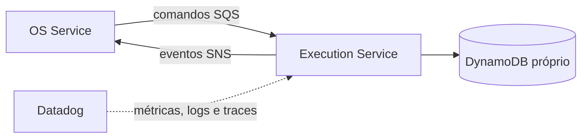

# Oficina Execution Service

Microsserviço responsável pela fila operacional, diagnóstico, reparos e conclusão da execução, com persistência DynamoDB e participação assíncrona na Saga de ordens de serviço.

## Tecnologias

Node.js 22, TypeScript, Docker, Kubernetes, Terraform, GitHub Actions, SonarCloud e Datadog. O banco definido é DynamoDB e a integração assíncrona usará SNS/SQS.

## Executar localmente

```bash
npm ci
npm run test:coverage
npm run dev
```

Health check: `GET http://localhost:3000/health`.

## Build e deploy

```bash
npm run build
docker build -t oficina-execution-service .
kubectl apply -f k8s/
terraform -chdir=infra init -backend=false
terraform -chdir=infra validate
```

O CI valida tipos, testes com cobertura mínima de 80%, build, auditoria crítica e imagem. Após CI bem-sucedida em `homolog` ou `main`, o CD publica uma imagem imutável no GHCR e faz rollout no EKS. `homolog` usa o GitHub Environment `hml`; `main` usa `prod`, protegido por aprovação. O acionamento manual permanece disponível para contingência.

Variáveis dos Environments: `AWS_REGION`, `EKS_CLUSTER_NAME` e `EXECUTION_TABLE_NAME`. Segredos: `AWS_ACCESS_KEY_ID`, `AWS_SECRET_ACCESS_KEY` e `AWS_SESSION_TOKEN`. O acesso aos recursos AWS deve ser limitado à tabela e aos tópicos/filas do serviço.

Os manifestos incluem Deployment com rollout sem indisponibilidade, probes de inicialização/prontidão/vida, limites de recursos, contexto restritivo, HPA por CPU e memória, Service, ConfigMap e PodDisruptionBudget.

## Arquitetura do serviço



O serviço nunca acessa bancos dos demais microsserviços.

## API e documentação

- [Arquitetura e limites](docs/architecture.md)
- [Contratos de mensageria v1](docs/contracts.md)
- [Visão integrada da mensageria](https://github.com/maypinheiro/oficina-api/blob/develop/docs/fase4/fase3-mensageria-basica.md)
- [Saga orquestrada e compensações](https://github.com/maypinheiro/oficina-api/blob/develop/docs/fase4/fase4-saga-implementada.md)
- [Migração e isolamento dos dados](docs/data-migration.md)
- Swagger/OpenAPI: será publicado com os endpoints operacionais; nesta fase somente `/health` existe.
- [Arquitetura geral e Saga no OS Service](https://github.com/maypinheiro/oficina-api/tree/develop/docs/fase4)

## Persistência e integração

A tabela DynamoDB própria e os scripts de migração/reconciliação estão versionados. Os contratos SNS/SQS, inbox idempotente e handlers de comandos da Saga estão documentados e cobertos por testes.
