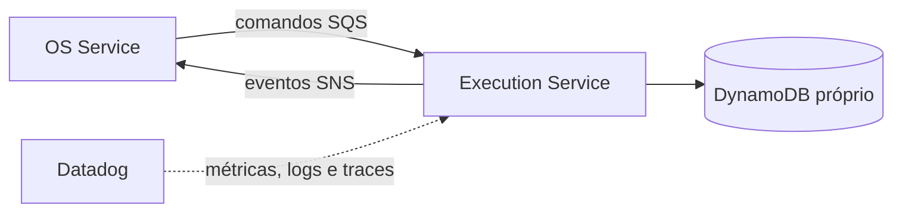

# Oficina Execution Service

Microsserviço responsável pela fila operacional, diagnóstico, reparos e conclusão da execução. A Fase 1 entrega a base independente; regras de produção, DynamoDB e mensageria serão implementadas nas fases seguintes.

## Tecnologias

Node.js 22, TypeScript, Docker, Kubernetes, Terraform, GitHub Actions, SonarCloud e Datadog. O banco definido é DynamoDB e a integração assíncrona usará SNS/SQS.

## Executar localmente

```bash
npm ci
npm run test:coverage
npm run dev
```

Health check: `GET http://localhost:3000/health`.

## Build e deploy

```bash
npm run build
docker build -t oficina-execution-service .
kubectl apply -f k8s/
terraform -chdir=infra init -backend=false
terraform -chdir=infra validate
```

O CI valida tipos, testes com cobertura mínima de 80%, build, auditoria crítica e imagem. O CD desta fase valida os artefatos; publicação ECR/EKS será habilitada após provisionamento dos ambientes.

## Arquitetura do serviço



O serviço nunca acessa bancos dos demais microsserviços.

## API e documentação

- [Arquitetura e limites](docs/architecture.md)
- [Contratos de mensageria v1](docs/contracts.md)
- [Visão integrada da mensageria](https://github.com/maypinheiro/oficina-api/blob/develop/docs/fase4/fase3-mensageria-basica.md)
- [Migração e isolamento dos dados](docs/data-migration.md)
- Swagger/OpenAPI: será publicado com os endpoints operacionais; nesta fase somente `/health` existe.
- [Arquitetura geral e Saga no OS Service](https://github.com/maypinheiro/oficina-api/tree/develop/docs/fase4)

## Estado da Fase 1

A tabela DynamoDB própria e os scripts de migração/reconciliação estão versionados. Filas, observabilidade distribuída e participação real na Saga ainda não foram implementadas.
