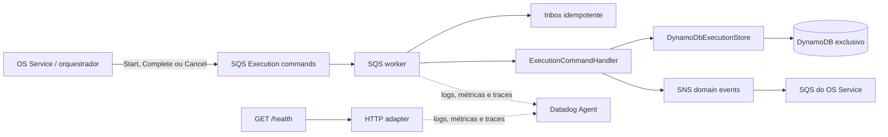
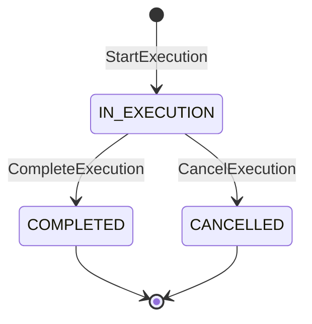
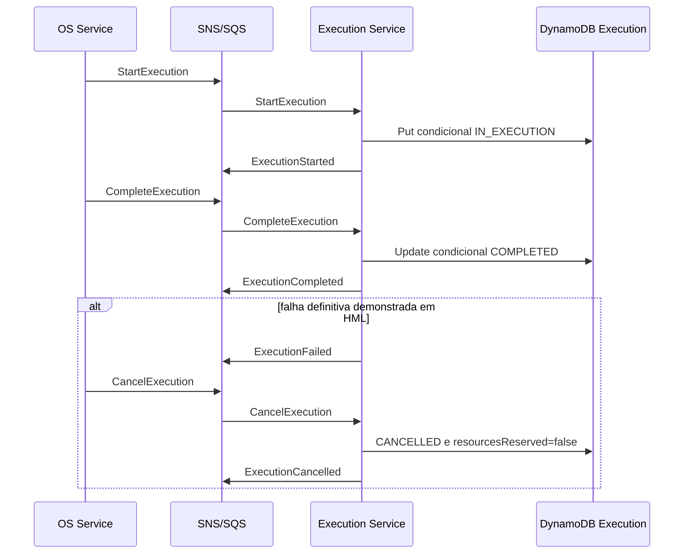

# Arquitetura do Execution Service

## Objetivo e limite de domínio

O Execution Service é responsável pela fila operacional, início da execução,
diagnóstico/reparo, conclusão técnica e liberação de recursos em uma
compensação. É o único proprietário dos dados de execução e não lê nem altera
os bancos do OS Service ou do Billing Service.

O serviço é participante da Saga orquestrada. Recebe comandos SQS, confirma
mudanças condicionais no DynamoDB e publica eventos SNS. O estado global da OS e
a decisão da próxima etapa continuam no OS Service.

## Visão de componentes

## Portas e adaptadores

| Camada | Implementação | Responsabilidade |
|---|---|---|
| Entrada HTTP | `src/app.ts` | health check; não altera estado operacional |
| Entrada assíncrona | `src/messaging/sqs-worker.ts` | long polling e ciclo de confirmação SQS |
| Aplicação | `src/saga/execution-command-handler.ts` | comandos e eventos da execução |
| Persistência | `src/saga/dynamodb-execution-store.ts` | escritas condicionais e transições no DynamoDB |
| Idempotência | `src/messaging/dynamodb-inbox.ts` | deduplicação persistente por `messageId` |
| Transporte | `src/messaging/aws-transport.ts` | publicação de eventos SNS |
| Observabilidade | `src/observability` | logs JSON, APM e métricas HTTP/mensageria |

## Modelo NoSQL próprio

A tabela DynamoDB é provisionada pelo Terraform deste repositório, em modo
`PAY_PER_REQUEST`, com criptografia, Point-in-Time Recovery e proteção contra
exclusão configurável.

| Item | PK | SK | GSI1PK | Uso |
|---|---|---|---|---|
| Execução | `EXECUTION#{executionId}` | `METADATA` | `STATUS#{status}` | estado e fila por status/data |
| Inbox | chave derivada de `messageId` | item de controle | — | rejeitar processamento duplicado |

O índice `GSI1` permite consultar a fila por status e ordem temporal sem scan.
O estado é alterado por expressões condicionais: `StartExecution` exige ausência
do item; `CompleteExecution` exige `IN_EXECUTION`. Isso impede criação duplicada
e conclusão fora de ordem.

## Comunicação e consistência

- não há escrita operacional por REST; o caminho de alteração é único e assíncrono;
- a fila exclusiva recebe `StartExecution`, `CompleteExecution` e `CancelExecution`;
- os resultados `ExecutionStarted`, `ExecutionCompleted` e
  `ExecutionCancelled` são publicados no tópico SNS;
- entrega é *at-least-once*, com inbox e condições DynamoDB contra duplicidade;
- `messageId`, `correlationId`, `sagaId` e `causationId` acompanham a cadeia;
- após cinco falhas de recebimento, a mensagem segue para a DLQ criptografada;
- nenhum evento é usado para realizar join ou consulta no banco de outro serviço.

## Participação na Saga

Na compensação, `CancelExecution` marca o item como `CANCELLED` e libera a
reserva operacional (`resourcesReserved=false`). O evento de conclusão permite
ao orquestrador solicitar a compensação da aprovação no Billing Service.

## Kubernetes, segurança e disponibilidade

- namespace `oficina-execution`, Deployment com duas réplicas e RollingUpdate;
- HPA por CPU/memória e PodDisruptionBudget;
- startup, readiness e liveness em `/health`;
- processo não-root, seccomp padrão, capabilities removidas, filesystem somente
  leitura e token de ServiceAccount desabilitado;
- configuração não sensível em ConfigMap e sessão temporária em Secret criado no CD;
- imagem imutável pelo SHA aprovado no CI;
- tabela, fila e DLQ são infraestrutura independente do serviço.

No Learner Lab, credenciais STS temporárias são injetadas no workload porque
IRSA/Pod Identity não está disponível. Em conta permanente, o alvo é uma
identidade de workload com acesso apenas à tabela, fila e tópico necessários.

## Observabilidade

Logs, spans e métricas preservam `service`, `env`, `version`, `correlationId`,
`sagaId`, `eventId`, `ordemServicoId` e tipo da mensagem. O dashboard da Saga
mostra mensagens processadas/duplicadas/com falha, duração p50/p95 e réplicas
do serviço. Dados sensíveis e credenciais não são enviados ao Datadog.

## Rastreabilidade

| Requisito da Fase 4 | Evidência neste repositório |
|---|---|
| Banco próprio NoSQL | `infra/main.tf` e `src/saga/dynamodb-execution-store.ts` |
| Infraestrutura própria | `infra/`, `k8s/` e `.github/workflows/cd.yml` |
| Fila e execução | `StartExecution` e GSI por status |
| Atualização de status | escritas condicionais no `DynamoDbExecutionStore` |
| Conclusão da execução | `CompleteExecution` → `ExecutionCompleted` |
| Compensação | `CancelExecution` → `ExecutionCancelled` |
| Idempotência | `src/messaging/dynamodb-inbox.ts` e condições DynamoDB |
| Cobertura mínima | `npm run test:coverage` com gate de 80% no CI |
| Kubernetes | Deployment, Service, HPA e PDB em `k8s/` |
| Observabilidade | `src/observability` e tags Datadog no Deployment |

As decisões e alternativas estão em [decisions.md](decisions.md), os contratos
em [contracts.md](contracts.md) e a arquitetura integrada no
[OS Service](https://github.com/maypinheiro/oficina-api/tree/main/docs/fase4).
